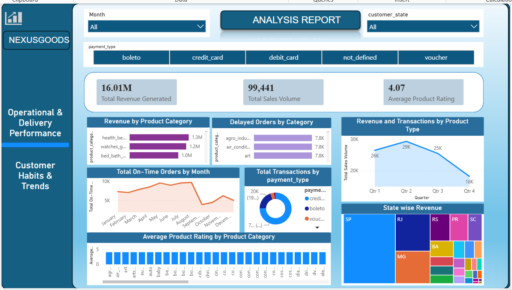

### NexusGoods E-Commerce Analytics

An end-to-end data analytics project focused on optimizing marketplace operations, tracking key performance indicators (KPIs), and driving strategic business decisions for an e-commerce platform. 

### Project Overview

This project provides actionable operational insights into sales performance, customer distributions, and transaction health. By leveraging structured relational databases and data visualization pipelines, it targets efficiency drops and isolates operational risk vectors within marketplace dynamics. 

### Core Technical Stack & Toolkit

* **Data Processing & Modeling:** Python (Pandas, NumPy), Jupyter Notebooks, Advanced Excel Macros
* **Business Intelligence & Dashboarding:** Microsoft Power BI (DAX, Power Query)
* **Version Control & CI/CD:** Git, GitHub

### Key Analytical Architecture

1. **Exploratory Data Analysis (EDA):** Cleaned, processed, and evaluated large-scale relational datasets within Jupyter Notebook environments to structure raw data arrays.
2. **Automated ETL Pipelines:** Constructed Python data scripts and advanced Excel macro structures to minimize repetitive manual weekly data collation hours and suppress pipeline latency.
3. **Visual Business Intelligence:** Engineered interactive dashboards tracking metrics across cross-departmental operations to supply leadership with clear objective indicators.

### Project Architecture & File Directory

* /ShopNext Store Capstone Project- Remica.pbip — Core Power BI Project structural repository file.
* /Shopnext Store Capstone Explanation.docx — Documented analysis, methodologies, and business interpretations.
* /README.md — Project roadmap and setup guide.

*Note: The primary Power BI architecture is captured within the .pbip schema layout. For rapid assessment of the dashboards without running local environments, please refer to the visual dashboard previews hosted in the primary overview repository.*
## Dashboard Preview

